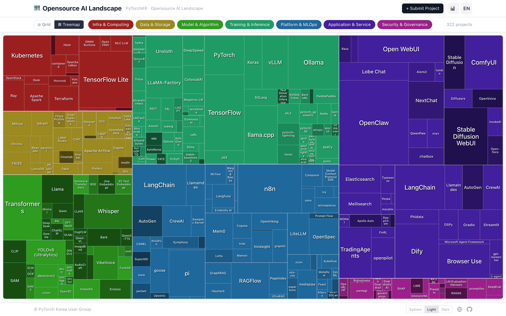

# Opensource AI Landscape

**English** | [한국어](README.ko.md)

🗺️ **https://landscape.pytorch.kr**

[](https://landscape.pytorch.kr)

## About

Opensource AI Landscape is an interactive visualization of open source projects related to AI.
The structure of the landscape comes from [AI Techmap](https://www.youtube.com/watch?v=z2Ge2QAEWbY), and the design takes ideas from [Newsmap](https://www.google.com/search?num=10&newwindow=1&udm=2&q=newsmap).

## Features

- **Treemap/Grid View**: Shows projects in 7 modules (infrastructure, data, models, training and inference, platform, applications, security).
- **Korean projects view**: To show only projects from Korean companies and institutions (`region: "KR"`), click the 🌐 button at the bottom right. When you hover over the button, it changes to 🇰🇷. The title then shows `(Korea🇰🇷)`. Click the button again to show all projects. When you hover over a Korean project, its card shows KR before the name. You can link to this view directly with `?scope=kr`.
- **Module Filter**: Shows only the modules that you select.
- **GitHub Stars based size**: The size of a project shows how well known it is.
- **Commit time based color**: The color of a project shows how recently it had a commit.
- **Multi-language**: Supports Korean and English.

## Request a project

To add an AI open source project, open an [add-project issue](https://github.com/PyTorchKR/landscape/issues/new?template=add-project.yml).
Select the repository URL, the module, and the category. A maintainer reviews the request and adds the project with the commands below.

## Maintainer commands

The commands work on issues with the `add-project` label. Only a repository OWNER, MEMBER, or COLLABORATOR can use them.
A command must be at the **start of the first line of the comment**. The workflow ignores `/approve` in other positions.

| Command | Action |
|---|---|
| `/approve` | Adds the project with the repository URL, module, and category from the issue body |
| `/approve <moduleId> <categoryId>` | Reads the repository URL from the issue body, and uses the module and category from the command |
| `/approve <owner/repo> <moduleId> <categoryId>` | Uses the repository, module, and category from the command (any issue body format works) |

```text
/approve
/approve platform-mlops memory-knowledge
/approve getzep/graphiti platform-mlops memory-knowledge
```

When a command succeeds, the workflow does these steps:

1. Gets the repository information (Stars, license, last commit, and more) from the GitHub API, and adds the project to `data/tools/<moduleId>/tools.json` and `data/categories/index.json`.
   - For a model, dataset, or collection that is only on HuggingFace, put the HuggingFace URL in place of the repository URL. The workflow then stores Likes and Downloads instead of Stars. HuggingFace models and datasets do not have a short description field, so the issue must include a description. The `/approve <owner/repo> ...` form works only for GitHub repositories.
   - If a maintainer adds the `Korea` label to the issue, the workflow also stores `region: "KR"`. The project then appears in the Korean projects view.
2. Commits to `main` (`feat: add <url> (closes #N)`).
3. Adds a result comment to the issue and closes the issue.
4. Runs Build & Deploy, so the site shows the project immediately.

If the command fails, the workflow adds a link to the workflow log on the issue. These are the common causes:

- The project is already in the landscape.
- The category does not belong to the module.
- The repository is private or does not exist.

You can find the module IDs and category IDs in [`data/modules/index.json`](data/modules/index.json) and [`data/categories/index.json`](data/categories/index.json).

### Rebuild the site

Build & Deploy runs automatically on each push to `main` and every day at 03:00 KST. Each run also updates the repository URLs and Stars.
The refresh saves successful results and records each failed attempt in `meta.lastFetchAttempt` and `meta.fetchError`.
If a source fails, its prior values and `meta.fetchedAt` stay unchanged.
The workflow commits the `data` directory and publishes available updates.
The known 404 responses from `wrtnlabs/autobe`, `wrtnlabs/agentica`, and `furiosa-ai/furiosa-rngd-validator` produce warnings and keep prior values.
Other failures still return a nonzero exit code.
The separate `check-refresh` job reports those failures and keeps deployment independent.

The refresh follows GitHub redirects to update `githubUrl` after repository renames and transfers.
It preserves project display names in `name`, including branding and capitalization.
The refresh keeps URL subdirectory paths, queries, and fragments.
Project IDs and category references stay unchanged, and HuggingFace entries keep their display names.
The job summary lists each repository URL change.

To run it manually, click **Build & Deploy → Run workflow** in the Actions tab, or use this command:

```bash
gh workflow run daily-update.yml -R PyTorchKR/landscape
```

## Development and contributing

The project uses [pnpm](https://pnpm.io) 9.15.9 (`packageManager` in `package.json`). We recommend Node.js 22 or later with Corepack.

```bash
corepack enable
pnpm install
pnpm dev
```

| Command | Description |
|---|---|
| `pnpm dev` | Starts the local development server |
| `pnpm build` | Checks types, then builds for production into `dist/` |
| `pnpm preview` | Previews the build output |
| `GITHUB_TOKEN=... pnpm update-stars` | Updates Stars, Forks, and last commit data for all projects (Likes and Downloads for HuggingFace entries) |
| `GITHUB_TOKEN=... pnpm add-tool -- --github-url <url> --module-id <id> --category-id <id> [--description <text>] [--region KR]` | Adds one project locally (`/approve` uses this internally). `<url>` is a GitHub or HuggingFace URL |

### Data structure

```text
data/
├── modules/index.json        # The 7 modules and the categories of each module
├── categories/index.json     # Category definitions and the project IDs in each category
└── tools/<moduleId>/tools.json  # Project data for each module
```

## License

[MIT](LICENSE)
